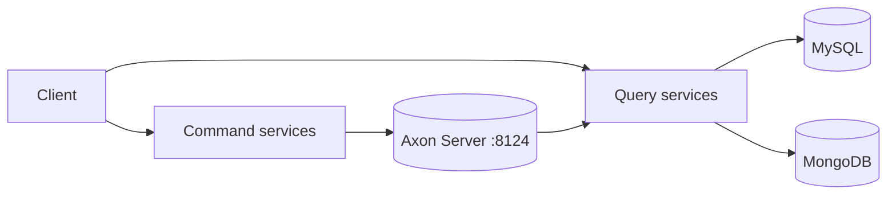

# Library CQRS with Axon Framework

A library management system built with **CQRS** and the **Axon Framework** on Spring Boot. Commands and queries are separated into different microservices that communicate through **Axon Server**, with MySQL and MongoDB read models.

Built from scratch over several labs of the middleware course at ESI Sidi Bel Abbès (2025-2026).

Course: Middleware and Services (2nd year, ESI-SBA), lab series by Dr. A. Malki.

## Architecture



Command services handle writes and publish events through Axon Server. Query services consume those events and maintain the read models.

## Modules

| Module | Port | Role |
|---|---|---|
| `core-api` | - | Shared commands, events and queries |
| `ms-command-library` | 8083 | Command side: library |
| `ms-Command-Library-book` | 8085 | Command side: books |
| `ms-command-library-book-stored` | 8088 | Command side: books, state-stored variant |
| `ms-editeur` | 8084 | Publisher (éditeur) service |
| `ms-query-library` | 8082 | Query side: library |
| `ms-query-join` | 8086 | Query side: joined view across services |
| `ms-query-mongo` | 8087 | Query side: MongoDB read model |

## Infrastructure

`docker-compose.yml` starts:

| Service | Port |
|---|---|
| Axon Server (UI / gRPC) | 8024 / 8124 |
| MySQL | 3306 |
| phpMyAdmin | 3737 |

## Tech stack

Java, Spring Boot, Axon Framework, CQRS, Axon Server, MySQL, MongoDB, Docker Compose, Maven, Postman.

## Run

1. Create your environment file and start the infrastructure:

```bash
cp .env.example .env      # then set MYSQL_ROOT_PASSWORD
docker compose up -d
```

2. Export the same database password for the services:

```bash
export DB_PASSWORD=<your MYSQL_ROOT_PASSWORD>
```

3. Install the shared module, then start each service:

```bash
cd core-api && ./mvnw install
cd ../ms-command-library && ./mvnw spring-boot:run
```

Repeat the last command for the other modules.

Axon Server dashboard: http://localhost:8024
phpMyAdmin: http://localhost:3737

## Try it

Import `TP-CQRS.postman_collection.json` into Postman to send commands and queries.

## Author

Hamza Benchehida, student in Web Information Systems at ESI-SBA.
